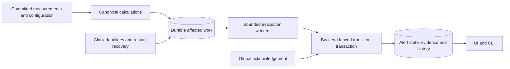

# ADR-0051: Durable alert policy state machine

- Status: proposed
- Created: 2026-11-12
- Accepted: pending
- Approval: pending; maintainer authorized drafts and a draft PR, not engine implementation
- Related specs: [SPEC-0021](../specs/0021-alert-policy-engine.md), [SPEC-0022](../specs/0022-alert-management-ui.md)
- Supersedes / superseded by: proposes superseding [ADR-0010](0010-alert-evaluation-and-delivery.md); not effective until acceptance

## Context

Almanac needs persistent alerts that explain their evidence, support team-wide
acknowledgement and continue evaluating during worker failures. The selected UI
starts with two paired-window burn conditions in one policy. Either condition
can activate the same alert; individual conditions do not own separate alerts.
The first outcome is visible in Almanac without an external destination.

ADR-0010 already establishes backend-owned persistence, exact calculations,
fenced workers and transactional transition events. Retain those boundaries.
Replace periodic full-policy scans and per-rule occurrences with durable affected
work and a policy-level state machine. The objective is bounded, observable
progress at the declared workload, not constant total work at arbitrary scale.

The maintainer selected initial verification at 100 and 200 configured policies.
Policy count, SLO count, condition count and active occurrence count are separate
dimensions. A policy initially selects one SLO; several policies can select the
same SLO. No 1,000-policy capability is claimed or required by this proposal.

## Decision

This is a proposal for review. Product behavior and review defaults are specified
in SPEC-0021; UI behavior and the selected mock references are in SPEC-0022.

### Backend-owned durable work

Use PostgreSQL as the first durable work store. Ingestion commits canonical
observations and calculation invalidation atomically under the existing contract.
Backend calculation publication records affected alert work in its transaction.
Policy activation, semantic revisions, exclusions and timer deadlines also create
durable work. A restartable scheduler derives due boundaries from persisted cursors
and the clock even when no observations arrive. An in-memory wakeup is an
optimization; losing it cannot lose the underlying work.

Persist a due range/cursor rather than one queue row per incoming datapoint.
Coalescing wakeups is safe only when the cursor still enumerates every eligible
evaluation boundary. Never replace an unevaluated range with its latest endpoint.
Event-driven processing still has a bounded scheduler/claim loop for deadlines,
leases and recovery. It does not require a continuously running full-rule scan.

Index SLI/SLO/policy dependencies. Reuse exact window calculations for policies
sharing the same SLO, bounds and revision snapshot. Keep evaluation windows
independent from graph resolution and extrema caches. Missing or pending derived
data is never zero burn. Calculations must use the canonical exact count/coverage
path; ingestion does not synchronously execute the alert state machine.

### Evaluation and transition ownership

Only the backend accesses application PostgreSQL. Embedded evaluation workers
invoke scoped application operations; later remote workers use equivalent
authenticated private APIs. Begin in the combined deployment, retaining bounded
evaluation pools, cancellation, lease expiry and health independently of ingestion.
Implementing a remote deployment is not a prerequisite for the initial outcome.

Each policy evaluation includes every condition at one effective boundary and one
consistent source/configuration snapshot. Compare exact counts and thresholds;
rounded UI values are not inputs. A worker submits its result with policy and
effective SLI/SLO revisions, exclusion revision, source generation, calculation
version, lease epoch and expected state version. The backend rejects stale
submissions. Unchanged input retries have the same logical evaluation identity.

The transition transaction atomically persists the evaluation result, occurrence
state, append-only transition/evidence, and cursor advancement. Acknowledge and
configuration operations use the same serialized state/version checks. No worker
can acknowledge or resolve a replacement occurrence by submitting an old ID.
Unique policy/occurrence and evaluation constraints prevent duplicate opens.

### Ordering, fairness and recovery

Process boundaries chronologically within a policy revision. Use short bounded
claims and fair rotation across policies so one backlogged policy does not own
the worker pool. Current work on other policies can progress; a backlogged
policy cannot jump its own cursor merely to appear current. Its lag remains visible.
Definition changes terminate the old revision with an explicit reason and fence
its workers; they do not pretend the old alert recovered.
The same transaction records the administratively cancelled pending range under
SPEC-0021, rather than silently advancing past it.

SPEC-0021 proposes a bounded automatic reconstruction horizon. Already committed
evidence is immutable and replayable. Uncaptured boundaries are evaluated using
retained facts available during reconstruction, with that provenance disclosed.
This is not a reconstruction of exactly what the system knew at the original
wall-clock instant. Late arrivals cannot silently rewrite committed decisions.
Unavailable/expired ranges have explicit outcomes; they cannot disappear behind
a cursor advance or become Healthy.

Retain transitions and their exact decision evidence for the existing 365-day
alert history period, protecting open occurrences and referenced records.
Compact unchanged evaluation results after the recovery horizon while retaining
coverage/outcome ranges and cursor continuity. Do not pin every calculation
snapshot or raw datapoint in an unbounded event log.

### Delivery boundary

The first implementation sends no external messages. Preserve stable transition
IDs, sequences and immutable evidence suitable for later notification work.
When delivery is added, create eligible destination work atomically with the
transition, and perform external I/O outside that transaction. Use independent
delivery admission, retries and transport adapters. Email, Slack and PagerDuty
are the intended sequence; provider-specific contracts remain later work.

The durability promise is no silent loss of committed transitions within database
durability guarantees, and an explicit outcome for each due evaluation boundary
within the recovery contract. It is not guaranteed observation coverage, recovery
beyond backup history, exactly-once notification receipt or a throughput result.

## Alternatives considered

- Periodically scan every policy: simpler scheduling, but ignores dependency
  indexing and needs separate durable ordering/catch-up machinery anyway.
- Evaluate synchronously on every datapoint: couples ingestion to policy volume,
  duplicates window work and cannot detect missing-data deadlines on its own.
- Consume only the latest state after an outage: lowers recovery cost but can
  erase a qualified breach and recovery between queued boundaries.
- Add a message broker now: offers transport/scaling options but introduces another
  persistence boundary and operational dependency without workload evidence.
- Direct database access from remote workers: simplifies claims but conflicts with
  backend ownership and expands schema/credential coupling.

## Consequences

Shared calculations and affected-work indexing reduce avoidable work. Fencing,
ordered cursors and atomic state transitions make retries and crashes testable.
They add storage, scheduler and API contracts that must be proven against real
PostgreSQL. Engine lag is distinct from source freshness and notification lag.

Automatic catch-up consumes resources and cannot reconstruct unavailable facts.
The proposed limits, cold-start behavior and administrative lifecycle need review.
The 100/200-policy fixtures validate only their documented workload and runner;
they neither cap the schema at 200 nor establish larger-fleet capacity.

## Revisit conditions

Revisit after measured lag, recovery time, database contention or independent
deployment requirements exceed the accepted limits despite bounded batching and
fairness. A broker, larger deployment or broader history guarantee requires new
evidence and a subsequent decision; benchmark failures do not silently weaken
correctness or omit evaluation boundaries.
