# Alert UI correction evidence, 2026-11-17

These are browser captures of the actual application routes with fictional API
fixtures, not mockup HTML. Before captures use product source at `9f54acd`; after
captures use the source hashes in [source.json](source.json). Desktop is 1440 px,
mobile is 360 px. Both themes are included. The isolated deployed save journey is
recorded separately below.

## Policies table

The name header now aligns with its linked row name; secondary columns are centred,
status uses the shared chip, and the pager is inside the resource panel. Mobile
uses labelled stacked rows instead of a desktop table requiring sideways scrolling.

| Before | After |
| --- | --- |
| 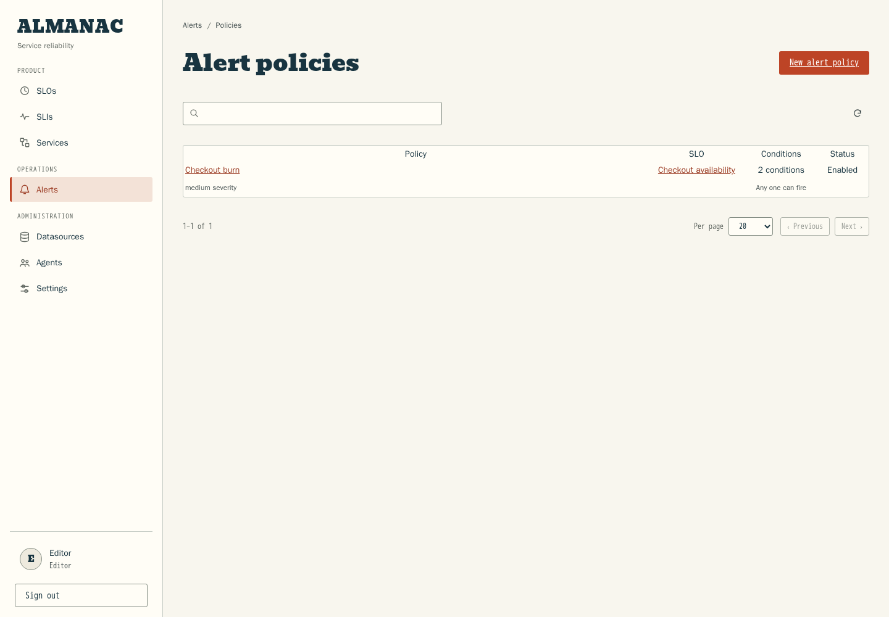 | 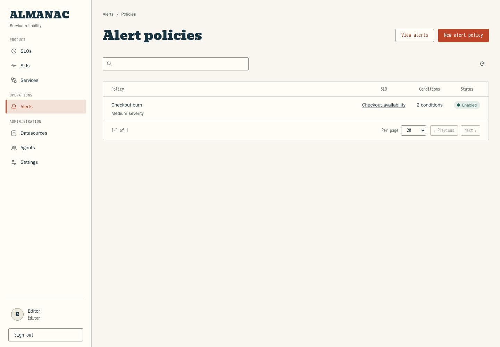 |
| 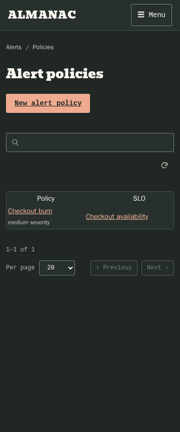 | 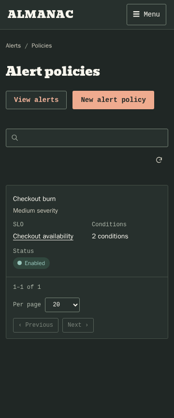 |

The existing Services page is the reference, captured with fictional fixtures:
[desktop light](after/services-reference-desktop-light.png),
[desktop dark](after/services-reference-desktop-dark.png),
[mobile light](after/services-reference-mobile-light.png),
[mobile dark](after/services-reference-mobile-dark.png).
A browser comparison checks equal font size, line height and first-cell inset in
all six viewport/theme combinations, including 1024 px intermediate layouts.

## Alert navigation

Active/History is now a toolbar choice below the title. Policies is beside the
page actions. Browser checks exercise arrow-key selection and Back navigation.

| Before | After |
| --- | --- |
| 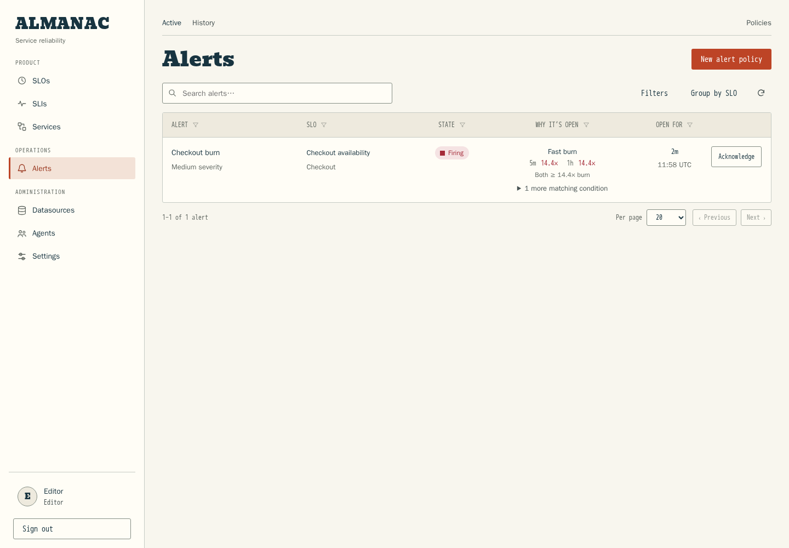 | 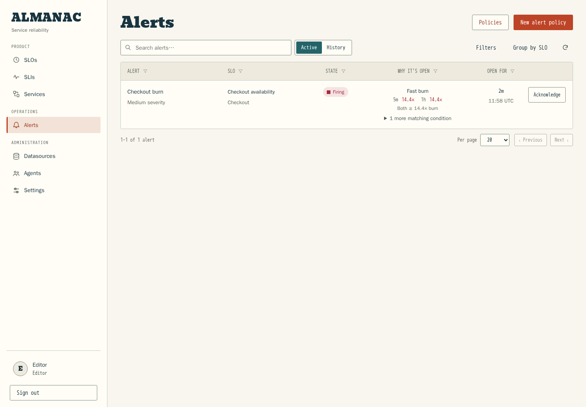 |

## Alert details

The state summary names the measured windows, burn values and threshold. Supporting
calculations, original evidence and technical revisions are under Evidence details.
Acknowledgement shows its actor/time and does not claim assignment. Sampling limits
are explained beside the chart without a page-level technical warning.

| Before | After |
| --- | --- |
| 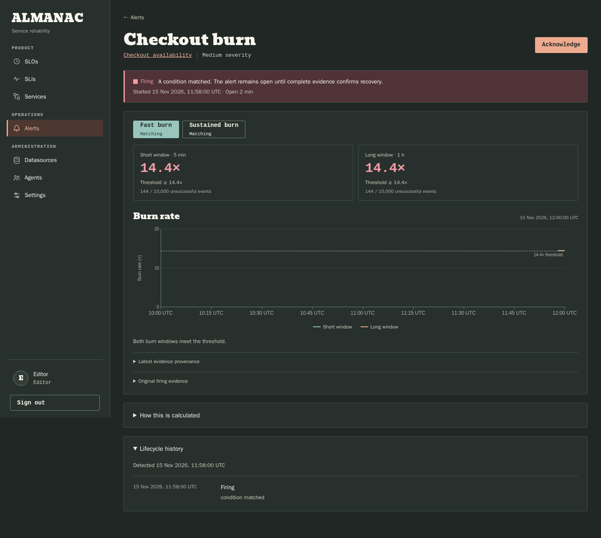 | 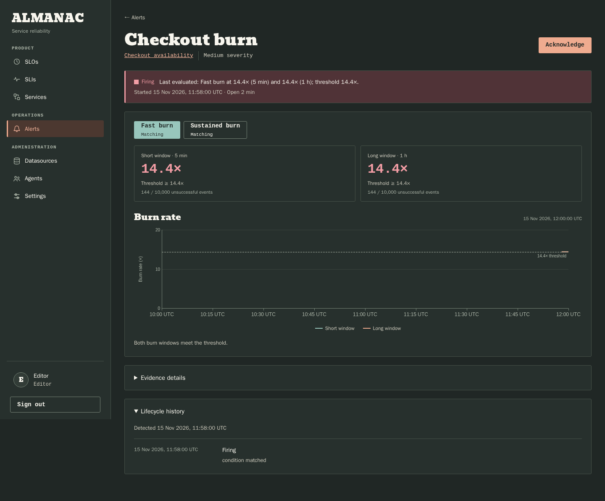 |
| 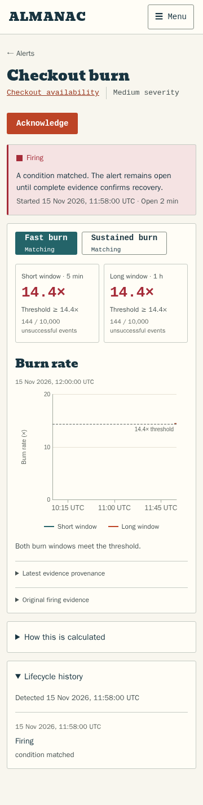 | 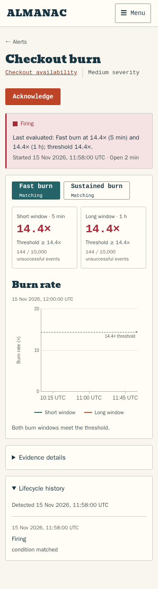 |

[Expanded calculations, light](after/details-expanded-desktop-light.png) ·
[Expanded calculations, dark](after/details-expanded-desktop-dark.png) ·
[Acknowledged alert with reduced chart detail](after/sampled-acknowledged.png).

The paired captures also include each page in desktop light/dark and mobile
light/dark in the `before/` and `after/` directories. They preserve all screenshots
without image editing. Fixtures contain no real operational data or credentials.

## Verification

Results and exact commands are recorded in [F4-T52](../../../tasks/F4-T52.md).
The route checks verify successful save navigation, uncertain-response reconciliation,
conflicting updates, viewer access, navigation history, responsive table geometry,
reduced chart detail and acknowledgement. Catalogue checks cover exact original/latest
values, disclosures, missing observations, keyboard/touch inspection and focus.
The normal Docker journey passes both onboarding and policy management (7.1 s
Playwright duration; about 3 min 40 s including fresh image builds, provider pulls,
startup and cleanup). Create and edit both return to the list; persisted values,
metadata-only revision behavior and disable/enable survive subsequent reads/reload.
The isolated stack is removed after the run. The deployed application image is
`sha256:be9aec3602ff1a039606633be81a6eeef21bb4ec6487e49905098964163bfa4c`.

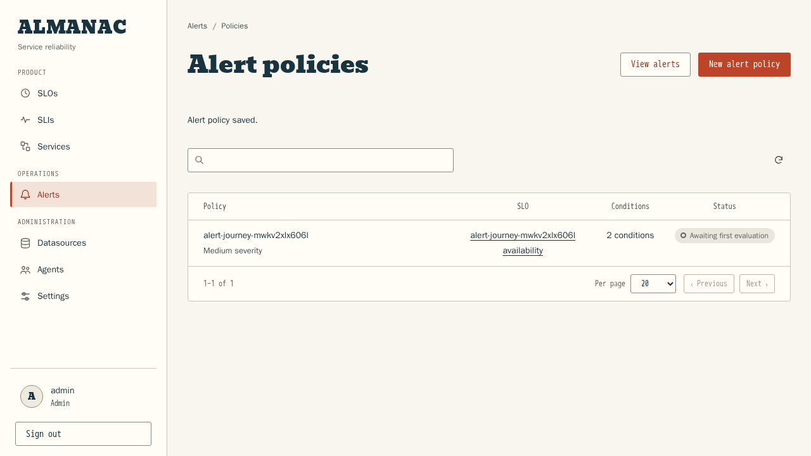

The deployed screenshot contains disposable test records. Detail, acknowledgement
and theme/mobile captures above use fictional API fixtures; this focused deployed
journey verifies policy management, not a new live firing/recovery run. Capacity,
performance and broad application suites were not run for this UI correction.
