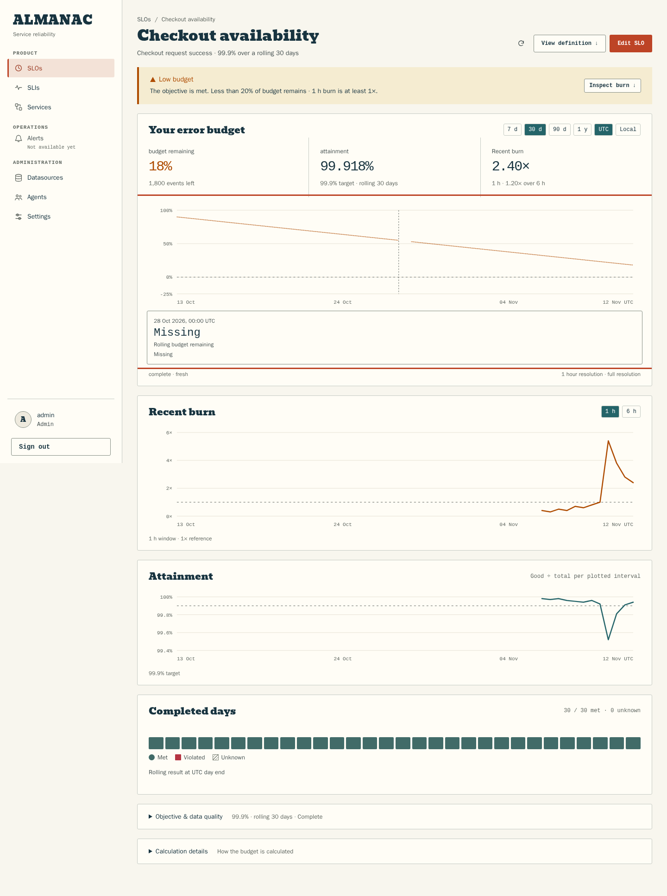
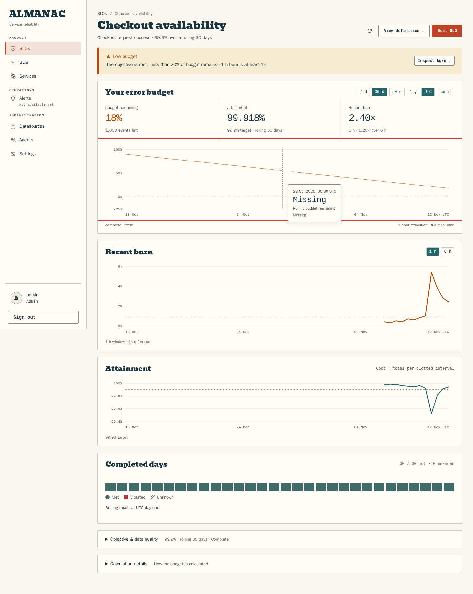

# SLO floating tooltip correction

The maintainer rejected PR #92's full-width inspection block. It incorrectly
changed hover details into document content, enlarging the chart and moving the
following panels. The earlier non-overlap assertion validated the chosen layout
without checking compactness or layout stability. This correction restores the
floating inspection interaction used before #92 and on the SLI detail chart.

The tooltip is absolutely positioned, bounded to 260 px, flips sides near the
chart edge, and offsets from the pointer vertically, flipping at viewport edges as the SLI
chart does. It retains the
existing exact-value content, crosshair, keyboard, Escape and touch dismissal.
The smaller dense-history markers and true missing-data gaps remain.

## Before and after

These full-page screenshots use the same deterministic 720-sample, 30-day fixture
and inspect the same missing evaluation. Before is from the source merged as
`29683a7`; after uses this correction. They show why compactness and page geometry
matter in addition to not overlapping a selected point.

| Before: expanding inspection block | After: floating tooltip |
| --- | --- |
|  |  |

Additional active-point views: [desktop light](hover-desktop-light.png), [desktop dark](hover-desktop-dark.png),
[mobile light](hover-mobile-light.png), [mobile dark](hover-mobile-dark.png).
These full-page captures show actual mouse hover.

## Verification

- The new browser regression failed on merged main because the chart grew and the
  tooltip exceeded its intended width.
- Six focused unit cases passed; TypeScript passed.
- All 25 SLO browser cases passed in 1.3 minutes, including both themes at
  360/1024/1440 px, dense partial/missing history, keyboard and touch. All 18
  zero-pixel non-hover graph reference comparisons remain unchanged.
- New assertions cover compact width, containment, selected-point clearance,
  unchanged chart height and unchanged document position of the next panel,
  keyboard selection at both ends, actual pointer hover and mouse-leave dismissal.
- An initial mobile assertion compared viewport coordinates across native focus
  scrolling. It now compares document coordinates, which detects layout movement
  independently of normal scrolling. No production change was needed for that
  assertion correction.

This is focused rendering/interaction evidence with validated API fixtures.
Native-container and performance suites were not repeated; broad PR gates run
in CI. Screenshots were visually inspected, including desktop and mobile right-edge
inspection; they do not establish physical-device or screen-reader acceptance.
